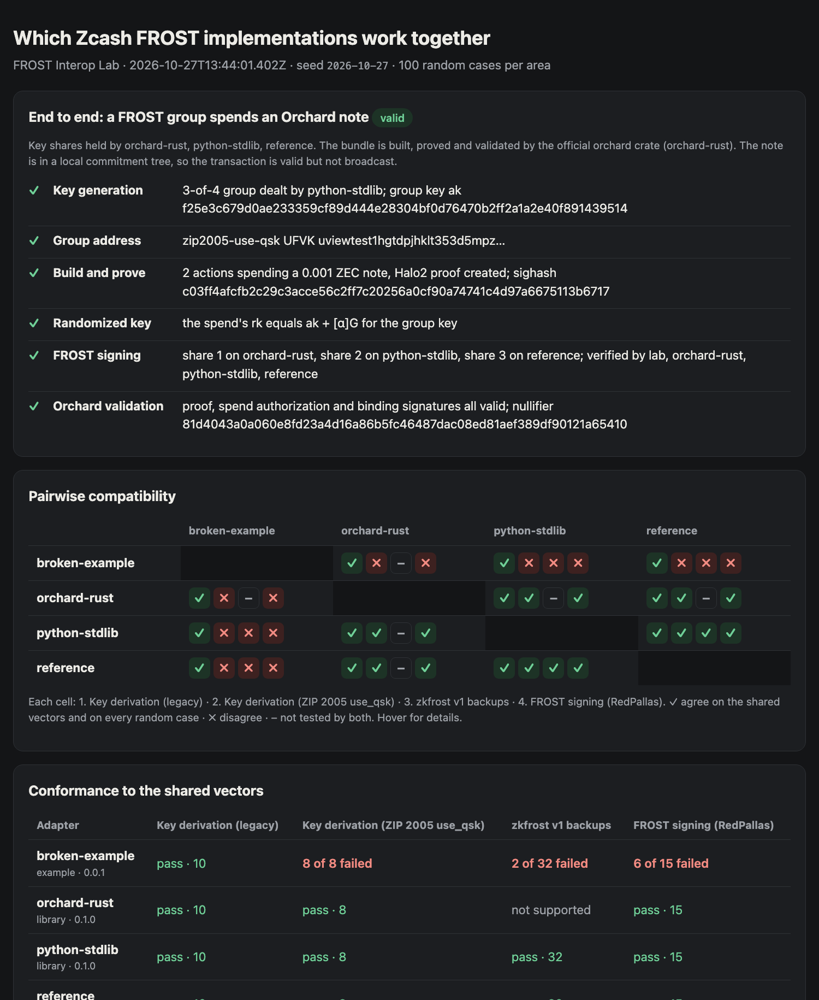

# FROST Interop Lab

**Conformance and interoperability tests for Zcash FROST wallets.** Shared test vectors, a small adapter protocol any wallet can implement in an afternoon, and a report of which implementations actually work together, ending in a real Orchard spend signed by a group whose shares live in three different implementations.



## Why

At least six teams ship or are building FROST shared-custody wallets for shielded ZEC: Zkool, Zafe, Konclave, Quorum, NoirWallet and OpenPGP Wallet. As the [interoperable FROST co-signing grant thread](https://forum.zcashcommunity.com/t/interoperable-frost-co-signing-for-shielded-zec-open-specs-and-a-reference-implementation/58172) puts it, *"each wallet is defining its own coordinator-to-signer messages and its own share backups."*

A shared spec and a backup-format ZIP are on the way. Until now, though, nothing checked implementations against each other; the first cross-wallet test was being arranged by hand.

The stakes are concrete. Two FROST key derivations are in use today:
- **Legacy:** the protocol spec's `nk` and `rivk`, with the group `ak` swapped in. ZF's `zcash-sign generate` uses this.
- **ZIP 2005 `use_qsk`:** quantum-recoverable `rivk`. Zafe and Zkool's newest groups use this.

For the same group they give **different addresses**. A wallet that restores a group with the wrong derivation scans the wrong address and shows a zero balance. The lab makes that kind of mismatch visible before users hit it.

## What it checks

| Area | Vectors | Source |
| --- | --- | --- |
| Key derivation, `legacy` | 10 | Official [zcash-test-vectors](https://github.com/zcash/zcash-test-vectors) Orchard key components |
| Key derivation, `zip2005-use-qsk` | 8 | [frost-tools#610](https://github.com/ZcashFoundation/frost-tools/pull/610) (generated by zafe-core, recomputed independently) |
| `zkfrost` v1 member backups | 5 valid (×3 spellings), 12 must-reject | Format from [Zkool](https://github.com/hhanh00/zkool2/blob/main/rust/src/frost/backup.rs); vectors generated by this lab |
| FROST signing (RedPallas) | 4 valid signatures, 6 tampered (incl. non-canonical `S`) | Signed with ZF's FROST(Pallas, BLAKE2b-512) from `reddsa`; verdicts from the `orchard` crate's verifier ([generator](vectors/generate_redpallas_spendauth.ts)) |

On top of the fixed vectors, the lab runs **differential tests**: it feeds every adapter the same random inputs (valid Pallas `ak` points, random `sk`, random backups) and compares every pair. Encoders and decoders are crossed, so implementation A's backup string must restore in implementation B. Runs are seeded and reproducible.

**Signing interop.** For every pair, the lab acts as FROST coordinator for a random t-of-n group (2 ≤ t ≤ n ≤ 5) whose key one implementation deals and whose shares are split between both. Each signer runs round 1 and round 2 of re-randomized FROST with a random randomizer α, exactly as an Orchard spend needs. The lab aggregates the shares, names any bad one, and every implementation verifies the final RedPallas signature under `rk = ak + [α]G`.

**End to end.** One group, with a share in each passing implementation, spends a real Orchard note:
1. The `orchard` crate builds the bundle and creates the Halo2 proof.
2. The group signs the bundle's ZIP 244 digest with the spend's own α.
3. The `orchard` crate's `BatchValidator` checks the proof, the group's spend authorization signature and the binding signature.

The note sits in a locally built commitment tree, so the transaction is fully valid against that anchor but is not broadcast.

## Quick start

Requires Node 22.18+ and Python 3, with no packages to install. The `orchard-rust` adapter, which builds the Orchard spend, needs Rust: `cd adapters/orchard-rust && cargo build --release`.

```sh
npm test                              # unit tests, mixed-group signing, the Orchard spend, a lab run
node src/cli.ts run --fuzz 100        # writes reports/report.{json,md,html}
node src/cli.ts spend                 # a 3-of-4 group across Rust, Python and TypeScript spends an Orchard note
node src/cli.ts run --adapters reference,python-stdlib --seed 2026-10-27
node src/cli.ts list
```

The exit code is 1 if any tested pair is incompatible or the end-to-end spend fails, so it drops straight into CI. See `.github/workflows/lab.yml`.

## Adapters

| Adapter | What it is | Status |
| --- | --- | --- |
| `reference` | This lab's TypeScript implementation. BLAKE2b, BLAKE3, Pallas (field and curve), bech32m and FROST are written from the specs, with no dependencies. | Passes all vectors |
| `python-stdlib` | Independent Python, standard library only. Derivation follows Zafe's checker; FROST and Pallas points written separately from the TypeScript. | Passes all vectors; agrees with every other implementation on every random case |
| `orchard-rust` | The official crates: `orchard` + `zcash_keys` for keys, ZF's `reddsa` FROST(Pallas, BLAKE2b-512) with `frost-rerandomized` for signing (what `zcash-sign` uses), and `orchard`'s PCZT roles, prover and `BatchValidator` for the spend. | Built in CI; passes all vectors, including addresses and UFVKs; signs in mixed groups; builds and validates the end-to-end spend |
| `broken-example` | Four deliberate, realistic bugs: `rivk` reduced mod p instead of q; backups accepting `id > n`; a signer that ignores the randomizer α; a verifier that accepts `S ≥ q`. | Shows what a failure looks like |

**Wallet teams:** an adapter is a few dozen lines that read JSON lines on stdin and write JSON lines on stdout. See **[ADAPTERS.md](ADAPTERS.md)**.

## Roadmap

1. **Wallet adapters:** Zkool, Zafe and OpenPGP Wallet first, since their stacks are already public. Each one plugs into the signing session and the end-to-end spend unchanged.
2. **On chain:** spend a funded testnet note instead of a locally anchored one, and broadcast it.
3. **DKG:** add distributed key generation ops next to the trusted dealer, so groups can be formed across wallets too.
4. **Group descriptor and backup ZIP:** track the spec as it settles and publish its vectors here.
5. **Hosted matrix:** a public page, regenerated in CI, showing which wallets interoperate today.

## Honest limitations

- The derivation vectors for `zip2005-use-qsk` are not official ZIP vectors yet. They come from Zafe and were independently recomputed; this lab is the third independent implementation to agree with them.
- The backup vectors are generated by this lab from Zkool's format and haven't yet been checked against Zkool's own binary.
- `orchard-rust` uses `zcash_keys`' `unstable-frost` API, which upstream may change, and `reddsa` 0.5.2, the last release with the FROST ciphersuite before it moves to ZF's `frost` repository.
- The end-to-end spend is validated by the `orchard` crate but not broadcast: its note is in a local commitment tree, not on chain.
- Keys come from a trusted dealer (`frost_keygen`), not DKG.
- No real wallet's code is wired in yet; the three passing implementations are libraries.

## License

MIT OR Apache-2.0. Vector files keep their upstream provenance; see the `source` and `license` fields in each file under `vectors/`.
